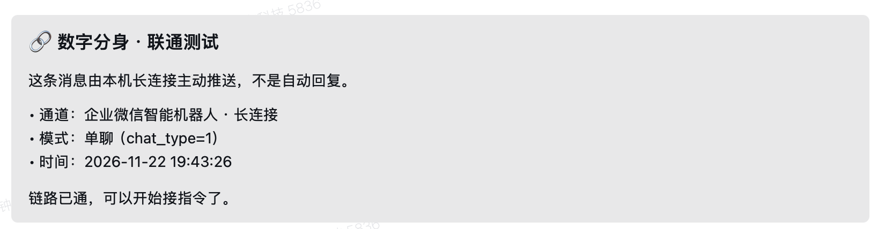

# 数字分身 · 企业微信群里的本机 AI 助手

在企业微信群里 @ 一下机器人，它在你**自己的机器上**执行任务，把结果推回群里。

不需要公网 IP，不需要域名备案，不需要内网穿透。

```text
你：   @数字分身 commits payment-service main 5
它：   ⏳ 收到，正在处理…
它：   ### 📦 payment-service
       **分支**：`main` ｜ 最近 5 条提交

       **1.** `a3f21c9` fix: 回调幂等判断漏了 orderId
       　　👤 张三 ｜ 🕐 11-16 10:55
       **2.** `8b1e044` feat: 增加退款重试
       　　👤 张三 ｜ 🕐 11-16 09:12
       …
```

---

## 它解决什么问题

很多人第一反应是「这不就是个群机器人」。差别在于**它能碰到你的机器**：

| 方案 | 能做到什么 | 差在哪 |
|---|---|---|
| 企微自带智能机器人 + 知识库 | 问答、查文档 | 碰不到你的代码库、shell、本地服务 |
| n8n / Dify 之类的工作流平台 | 编排 API 调用 | 要多维护一套服务；而且跑在云端，不在你的机器上 |
| **本项目** | 一行指令直达你本机的 GitLab、CLI 和文件 | 需要你在自己机器上跑一个常驻进程 |

典型用途：

- 通勤路上想看一眼某个服务最近改了什么、流水线有没有挂
- 同事在群里问「昨天那个 bug 修了吗」，不用开电脑就能查
- 让本机的 AI 帮你处理文件、整理内容，结果直接发到群里

## 两个关键设计（读代码前先看这两条）

**一、用长连接，不用 URL 回调。**
企业微信智能机器人支持「长连接（WebSocket）」和「URL 回调」两种接入。回调要求你有公网 IP、域名和备案；长连接由本机主动外连，**只要这台机器能上网就行**。这是本项目能在个人电脑上跑起来的前提。

**二、先回「收到」，再异步执行。**
企微机器人有 **3 分钟响应窗口**，超时就报错。所以收到指令立刻 ACK，真正的活儿放到后台任务里，做完再主动推送——这样单条指令跑 10 分钟也不影响。

## 30 秒验证，不需要任何密钥

环境要求：**Python 3.10+**（代码使用了 `X | None` 联合类型语法），以及 Python 3.10+ 自带的 `venv`。

```bash
python3 -m venv .venv
./.venv/bin/pip install -r requirements.txt
./.venv/bin/python selftest.py parse
```

`parse` 只测指令解析，不连任何外部服务。看到下面这样逐条打勾，说明代码是好的：

```text
─── 1. 指令解析 ───
  ✅ 'commits fund-product main 5' → (commits, ['fund-product', 'main', '5'])
  ✅ '提交 my-proj' → (commits, ['my-proj'])
  ✅ '@数字分身 commits demo' → (commits, ['demo'])
  ✅ 参数解析 commits myproj 99 → (myproj, master, 30)（数字=条数，截断到 30）
  …
```

其它分项自测：`./.venv/bin/python selftest.py gitlab` / `cli` / `ws`（`ws` 需要 Secret）。

### 实测到什么程度

不夸大，逐项说清楚（2026-11，macOS + Python 3.13）：

| 链路 | 状态 | 证据 |
|---|---|---|
| 指令解析 | ✅ 已实测 | `selftest.py parse` 12 项断言全过 |
| GitLab 查询 | ✅ 已实测 | 真实实例取回提交记录并渲染推送 |
| 长连接鉴权 | ✅ 已实测 | `aibot_subscribe` 返回 `errcode 0` |
| 主动推送 | ✅ 已实测 | `aibot_send_msg` 返回 `errcode 0`，消息真实到达单聊 |
| 群内 @ 触发 | ⚠️ 逻辑完整但未在群场景验证 | 单聊链路已通，群聊共用同一套回调处理 |
| 本机 CLI 后端 | ⚠️ 视 CLI 版本而定 | 部分版本 `--serve`/`-p` 模式会初始化失败，改用 `llm` 后端更稳 |

主动推送的实机效果（这条是进程主动推的，不是收到消息后的自动回复）：



## 5 分钟接入

### 1. 创建机器人，拿 Bot ID 和 Secret

企业微信管理后台 → **安全与管理 → 管理工具 → 智能机器人** → 创建机器人
→ 进入详情 → 右上角 **编辑** → 选择 **API 模式创建** → 连接方式选 **使用长连接**
→ 页面会生成 **Bot ID** 和 **Secret**，复制保存。

> ⚠️ 这个 Secret 是「长连接」专用的，和 URL 回调模式的 Token / EncodingAESKey 不是一回事。
> 同一机器人同一时刻只能保持一个长连接，重复启动会互踢。

### 2. 授权「消息」权限

如果调用时返回 `850003 authorization expired`，说明机器人创建者还没完成授权，点一下授权链接即可。

### 3. 填配置

```bash
cp config.example.yaml config.yaml
chmod 600 config.yaml
```

必填三处：`wecom.bot_id`、`wecom.secret`、`gitlab.token`（GitLab → Preferences → Access Tokens → 勾 `api`）。

`gitlab.default_project` 建议填**完整路径**（如 `your-group/your-project`），不要只写项目名——GitLab 的 `/projects/:id` 只接受数字 ID 或完整路径，写短名会直接 404。

自然语言的活儿可选两种后端：直连大模型（`llm.api_key`），或调用本机 CLI（`workbuddy.cli_path`）。都不配也不影响内置指令。

### 4. 启动

```bash
./start.sh
tail -f logs/bot.log      # 看到「长连接建立完成，等待群消息…」就是成功了
```

停止：`./stop.sh`

## 群内指令

| 指令 | 说明 |
|---|---|
| `commits <项目> [分支] [条数]` | 最近提交记录，默认 10 条，上限 30 |
| `pipelines <项目> [分支]` | 流水线状态 |
| `branches <项目>` | 分支列表 |
| `projects <关键词>` | 搜索项目 |
| `status` | 连通性自检（长连接 / CLI / LLM / GitLab 四项） |
| `help` | 帮助 |
| 其它任何话 | 交给大模型或本机 CLI 处理 |

示例：`@数字分身 pipelines payment-service main`

## 常见问题

| 现象 | 原因 | 处理 |
|---|---|---|
| `853000 invalid bot_id or secret` | Secret 填错 | 回机器人详情页，确认复制的是**长连接**那栏的 Secret。注意它和 URL 回调模式的 Token / EncodingAESKey 长得一样长，肉眼分不出来，只能回去核对 |
| `850003 authorization expired` | 机器人「消息」权限过期 | 创建者点一下授权链接续期。过期是常态，隔一段时间会失效 |
| `850002 no authorization` | 「通讯录」权限未授权 | **不影响使用**。只有想按姓名反查 userid 才需要它；主动推送用 `message aibot sessions list` 拿 chatid 即可 |
| GitLab 返回 404 | `default_project` 写成了短名 | 改成完整路径 `group/project`，或直接填项目数字 ID |
| `853006` | 会话存档接口未对企业开通 | 与本项目无关。这也是必须走推送模式、不能主动拉群消息的原因 |
| 两个实例互相踢下线 | 同一机器人只允许一个长连接 | 只跑一个；要冗余得做主备切换，不能并行 |
| 指令回了「收到」但一直没结果 | 后台任务异常 | `tail -f logs/bot.log` 看堆栈；`status` 查后端是否就绪 |
| 长消息被截断 | 企微 markdown 单条约 4096 字节 | 代码已在 3500 字节处主动截断并标注 |
| 机器人无法主动发起第一条消息 | 企微协议限制 | `aibot_send_msg` 需要 `chatid`，而 `chatid` 只能从回调帧或 `sessions list` 拿到。冷启动时必须先有人跟机器人说过话 |

## 架构

```text
群里 @机器人 "commits payment-service"
        │
        ▼
企业微信云 ──WebSocket 长连接──▶ agent.py（本机守护进程）
                                      │
                                      ├─ 内置指令 ──▶ GitLab API
                                      │
                                      └─ 其它指令 ──▶ LLM API ／ 本机 CLI
        │
        ▼
结果以 markdown 推送回群
```

## 目录结构

```text
wecom-local-agent/
├── agent.py              # 守护进程：消息分发与编排
├── wecom_client.py       # 长连接客户端（鉴权 / 心跳 / 重连 / 收发）
├── executor.py           # 本机 CLI 执行器
├── llm_runner.py         # OpenAI 兼容后端 + 工具调用
├── skills/
│   ├── router.py         # 指令解析与路由
│   └── gitlab_skill.py   # GitLab 查询与结果格式化
├── selftest.py           # 分项自测
├── config.example.yaml   # 配置模板（真实配置见 config.yaml，已被 git 忽略）
├── start.sh / stop.sh
└── docs/images/          # README 配图
```

## 设计取舍

- **为什么 `msgid` 要落盘**：断线重连时服务端会重推消息，不去重就会把同一条指令执行两遍。`state/processed.json` 保留最近 500 条。
- **为什么要有双后端 + auto 降级**：本机 CLI 依赖桌面端开着，LLM 依赖网络和额度。任何一个挂了，另一个还能用，不至于让机器人整个哑掉。
- **为什么内置指令不交给大模型**：`commits`、`pipelines` 这类是确定性查询，走 API 直连又快又省钱，还不会产生幻觉。
- **为什么不用主动拉群消息**：会话存档接口需要企业单独开通（返回 `853006`），所以只能被动接收推送。

## 已知约束

- 需要一台常开的机器（笔记本合盖会断）
- 同一个机器人只能有一个长连接
- 只实现 `message.text` 事件，图片、文件消息未处理
- GitLab 相关指令依赖 `api` 权限的 Token

## License

[MIT](LICENSE)
